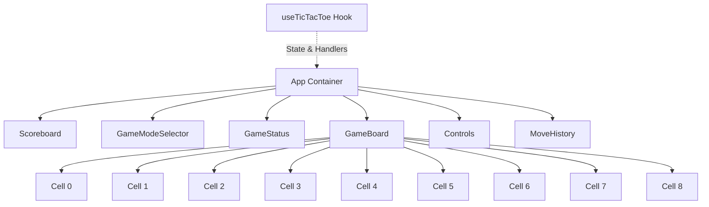
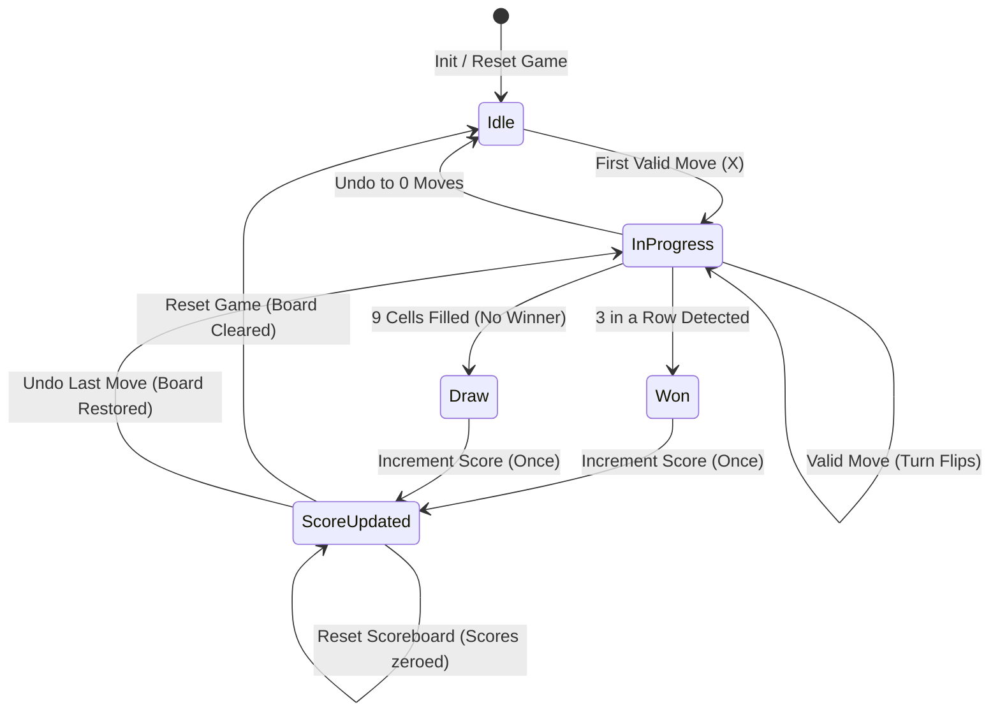
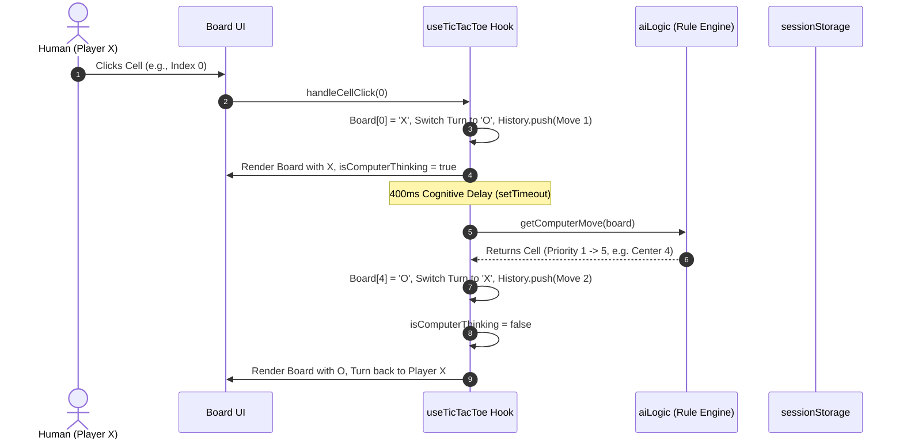
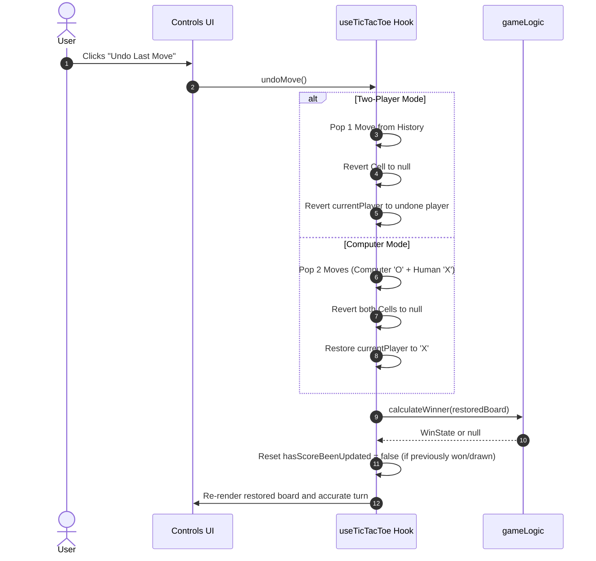
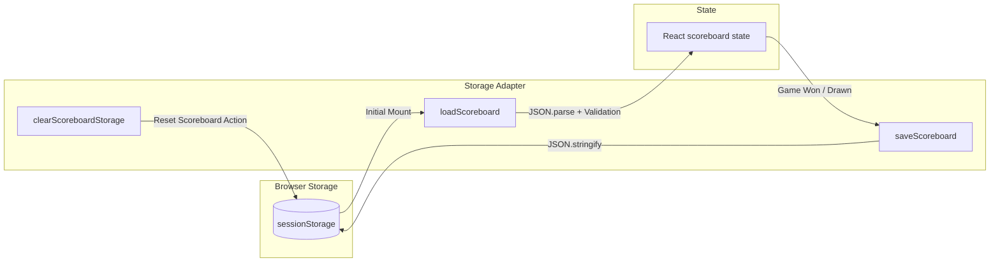

# Tic Tac Toe - System Architecture & Design Specification

## 1. Architectural Overview

The Tic Tac Toe application is engineered using clean architecture principles, separating user interface, state management, pure algorithmic logic, and browser storage persistence.

```
┌─────────────────────────────────────────────────────────────┐
│                       Presentation Layer                    │
│   (App, Scoreboard, GameModeSelector, GameStatus,           │
│    GameBoard, Cell, Controls, MoveHistory)                  │
└──────────────────────────────┬──────────────────────────────┘
                               │ Dispatches Actions / Subscribes
                               ▼
┌─────────────────────────────────────────────────────────────┐
│                 Application Logic Layer                     │
│                (useTicTacToe Custom Hook)                   │
│   - Game state machine & transitions                        │
│   - Dual-mode Undo transaction coordination                 │
│   - Automated AI turn scheduling & delay orchestration      │
│   - Once-per-game completion synchronization guard          │
└──────────────┬──────────────────────────────┬───────────────┘
               │ Invokes Pure Logic           │ Reads / Writes
               ▼                              ▼
┌──────────────────────────────┐ ┌────────────────────────────┐
│      Domain Logic Layer      │ │      Persistence Layer     │
│   - gameLogic.ts             │ │   - storage.ts             │
│     (Win & draw calculation, │ │     (sessionStorage        │
│      coordinate mapper)      │ │      adapter with JSON     │
│   - aiLogic.ts               │ │      validation & schema   │
│     (5-priority decision     │ │      fallback)             │
│      rule engine)            │ └────────────────────────────┘
└──────────────────────────────┘
```

---

## 2. Component Hierarchy & Data Flow



### Unidirectional Data Flow

1. **User Action**: The user clicks a cell or control button.
2. **Hook Handler**: `handleCellClick`, `undoMove`, `resetGame`, or `resetScoreboard` is invoked.
3. **Pure Logic Execution**: Game outcome, available moves, or next AI move are computed using deterministic pure functions.
4. **State Transition**: React hook updates its internal state.
5. **Re-render**: Presentational components receive fresh props and update the DOM.
6. **Side Effects**: If game is won or drawn, `useEffect` synchronizes the scoreboard with `sessionStorage` strictly once. If computer mode is active and it's 'O' turn, a timed AI move is triggered.

---

## 3. Game State Machine



---

## 4. Sequence Diagrams

### Computer Opponent Turn Execution



### Dual-Mode Undo Transaction



---

## 5. Storage Persistence Architecture



### Persistence Guarantees

- **Isolation**: Each browser tab maintains its own independent session.
- **Resilience**: Malformed or missing storage values automatically fallback to initial values (`{ xWins: 0, oWins: 0, draws: 0 }`).
- **Separation of Concerns**: Game board state is ephemeral in React memory; only session score tally is committed to `sessionStorage`.
- **Reset Orthogonality**: Resetting the game clears the board without mutating the scoreboard; resetting the scoreboard clears storage without interrupting the current match.

---

## 6. Mathematical Invariants & Testable Properties

1. **Board Cell Invariance**:
   $$\forall i \in [0, 8], \quad \text{board}[i] \in \{ \text{'X'}, \text{'O'}, \text{null} \}$$
2. **Move Count Invariance**:
   $$\text{board.filter}(c \neq \text{null}).\text{length} == \text{history.length}$$
3. **Turn Parity in Two-Player Mode**:
   $$\text{currentPlayer} = (\text{history.length} \pmod 2 == 0) \ ? \ \text{'X'} : \text{'O'}$$
4. **Turn Parity in Computer Mode**:
   $$\text{After human move: Turn is 'O'. After AI response: Turn is 'X'.}$$
5. **Scoreboard Integrity**:
   $$\text{Total Completed Games} = \text{xWins} + \text{oWins} + \text{draws}$$
   A single completed game increases Total Completed Games by exactly 1.
