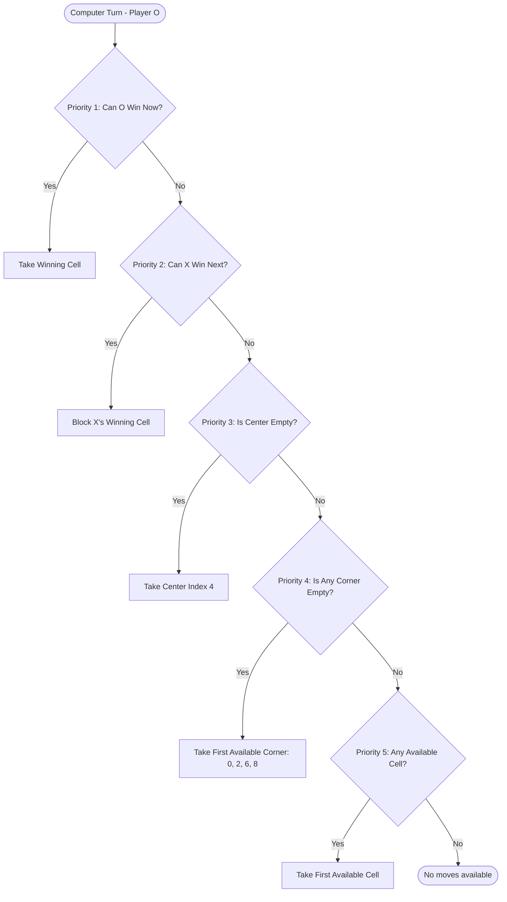

# Tic Tac Toe - Code Concepts & Technical Specifications

This document details the architectural paradigms, mathematical models, state transition logic, and algorithmic implementations for the browser-based Tic Tac Toe application.

---

## 1. Board Representation & Coordinate Transformation

### Mathematical Model

The 3x3 game board is represented as a 1D flat array of length 9:
$$\text{BoardState} = [c_0, c_1, c_2, c_3, c_4, c_5, c_6, c_7, c_8], \quad \forall c_i \in \{ \text{'X'}, \text{'O'}, \text{null} \}$$

```
Index Mapping:
[ 0 ] [ 1 ] [ 2 ]   -->   (Row 1, Col 1) | (Row 1, Col 2) | (Row 1, Col 3)
[ 3 ] [ 4 ] [ 5 ]   -->   (Row 2, Col 1) | (Row 2, Col 2) | (Row 2, Col 3)
[ 6 ] [ 7 ] [ 8 ]   -->   (Row 3, Col 1) | (Row 3, Col 2) | (Row 3, Col 3)
```

### Coordinate Conversion Formula

To satisfy the human-readable Move History requirement (`Row 1, Column 1`), we transform flat array index $i$ ($0 \le i \le 8$) into 1-based Row and Column coordinates:
$$\text{Row}(i) = \lfloor i / 3 \rfloor + 1$$
$$\text{Col}(i) = (i \pmod 3) + 1$$

In TypeScript:

```typescript
export function indexToRowCol(index: number): { row: number; col: number } {
  return {
    row: Math.floor(index / 3) + 1,
    col: (index % 3) + 1,
  };
}
```

---

## 2. Win & Draw Detection Algorithms

### Combinatorial Precomputed Win Matrix

There are exactly 8 possible winning lines on a 3x3 grid:

- 3 Horizontal Rows: `[0, 1, 2]`, `[3, 4, 5]`, `[6, 7, 8]`
- 3 Vertical Columns: `[0, 3, 6]`, `[1, 4, 7]`, `[2, 5, 8]`
- 2 Diagonals: `[0, 4, 8]`, `[2, 4, 6]`

```typescript
export function calculateWinner(board: BoardState): WinState | null {
  for (const line of WINNING_COMBINATIONS) {
    const [a, b, c] = line;
    if (board[a] && board[a] === board[b] && board[a] === board[c]) {
      return { winner: board[a] as Player, line };
    }
  }
  return null;
}
```

**Time Complexity**: $O(1)$ constant time (exactly 8 line comparisons).  
**Space Complexity**: $O(1)$ constant space.

### Draw Condition

A draw occurs if and only if:

1. `calculateWinner(board) === null` (no player has achieved 3 in a row).
2. `board.every((cell) => cell !== null)` (all 9 cells are filled).

---

## 3. Computer Opponent Decision Engine (5-Priority Strategy)

In Computer Mode, the human is **Player X** and the computer is **Player O**. The computer selects its next move using an immutable, deterministic 5-level priority rule engine:



### Algorithmic Implementation

```typescript
export function getComputerMove(board: BoardState): number | null {
  // Priority 1: Check if 'O' can win in this turn
  const winMove = findWinningCell(board, 'O');
  if (winMove !== null) return winMove;

  // Priority 2: Check if 'X' could win on next turn and block them
  const blockMove = findWinningCell(board, 'X');
  if (blockMove !== null) return blockMove;

  // Priority 3: Take center (Index 4) if available
  if (board[CENTER_CELL_INDEX] === null) {
    return CENTER_CELL_INDEX;
  }

  // Priority 4: Take corner if available ([0, 2, 6, 8])
  for (const corner of CORNER_CELL_INDICES) {
    if (board[corner] === null) {
      return corner;
    }
  }

  // Priority 5: Take any available cell
  for (let i = 0; i < board.length; i++) {
    if (board[i] === null) {
      return i;
    }
  }

  return null;
}
```

Helper function `findWinningCell`:

```typescript
function findWinningCell(board: BoardState, player: Player): number | null {
  for (const [a, b, c] of WINNING_COMBINATIONS) {
    const cells = [board[a], board[b], board[c]];
    const indices = [a, b, c];

    // Check if line has exactly 2 cells filled by target player and 1 empty cell
    const playerCount = cells.filter((c) => c === player).length;
    const emptyCount = cells.filter((c) => c === null).length;

    if (playerCount === 2 && emptyCount === 1) {
      const emptyIndex = indices.find((idx) => board[idx] === null);
      if (emptyIndex !== undefined) return emptyIndex;
    }
  }
  return null;
}
```

---

## 4. Move History & Mode-Aware Undo Transaction Model

### Data Structure: `MoveRecord`

Every valid cell selection records:

```typescript
export interface MoveRecord {
  moveNumber: number; // 1, 2, 3...
  player: Player; // 'X' | 'O'
  cellIndex: number; // 0..8
  row: number; // 1..3
  col: number; // 1..3
}
```

### Mode-Specific Undo Transactions

The Undo operation must restore the exact valid game state prior to the move(s):

#### Scenario A: Two-Player Mode

- User clicks Undo.
- Pop the single latest move $M_{last}$ from `history`.
- Set `board[M_{last}.cellIndex] = null`.
- Set `currentPlayer = M_{last}.player`.
- Recalculate win/draw status (if the undone move concluded the game, unlock the board).

```
State: [X at (1,1), O at (2,2)] -> Turn: X
Action: Undo
New State: [X at (1,1)] -> Turn: O
```

#### Scenario B: Computer Mode

- User (Player X) plays, then Computer (Player O) automatically plays.
- If User clicks Undo, removing only O's move would leave the board in an invalid state where it is O's turn, triggering the computer to move again immediately!
- Therefore, **Computer Mode Undo atomically reverts both moves together**:
  1. Pop Computer's move ($O$).
  2. Pop Human's move ($X$).
  3. Clear both cells on the board.
  4. Restore `currentPlayer = 'X'`.
- _Edge case handled_: If Undo is triggered before the computer has executed its move (e.g. during thinking delay), only 1 move ($X$) is popped and turn remains $'X'$.

```
State: [X at (1,1), O at (2,2)] -> Turn: X
Action: Undo
New State: [] -> Turn: X
```

### Scoreboard Rollback Protection

When a game reaches a win or draw, the scoreboard increments by +1. If a user subsequently clicks **Undo**:

1. The game status reverts to `in-progress`.
2. The `hasScoreBeenUpdated` flag resets to `false`.
3. The scoreboard itself retains its current tally (it does not decrement, maintaining cumulative completed game statistics), and when the game is played to completion again, it will increment cleanly.

---

## 5. Browser Session Storage Architecture

### Why `sessionStorage`?

Per requirements: _"maintain a session-level scoreboard... served on the frontend use up session based frontend browser storage based only"_.

- `sessionStorage` provides tab/window isolated storage that persists across page refreshes within the same browser session.
- Automatically resets when the user closes the tab, satisfying session isolation without polluting long-term browser storage.

### Atomic Once-Per-Game Synchronization Guard

To ensure the scoreboard increments strictly **once** per completed game (avoiding double-counting on component re-renders or extraneous clicks):

```typescript
const [hasScoreBeenUpdated, setHasScoreBeenUpdated] = useState<boolean>(false);

useEffect(() => {
  if (outcome === 'in-progress' || hasScoreBeenUpdated) {
    return;
  }

  // Increment tally
  setScoreboard((prev) => {
    const updated = {
      ...prev,
      xWins: outcome === 'won' && winner === 'X' ? prev.xWins + 1 : prev.xWins,
      oWins: outcome === 'won' && winner === 'O' ? prev.oWins + 1 : prev.oWins,
      draws: outcome === 'draw' ? prev.draws + 1 : prev.draws,
    };
    saveScoreboard(updated);
    return updated;
  });

  setHasScoreBeenUpdated(true);
}, [outcome, winner, hasScoreBeenUpdated]);
```

### Reset Boundaries

- **Reset Game**:
  - Resets `board`, `history`, `outcome`, `winner`, `currentPlayer = 'X'`, `hasScoreBeenUpdated = false`.
  - **Does NOT touch** `scoreboard` or `sessionStorage`.
- **Reset Scoreboard**:
  - Overwrites `scoreboard` in React state and `sessionStorage` with `{ xWins: 0, oWins: 0, draws: 0 }`.
  - **Does NOT reset** the ongoing game board.
